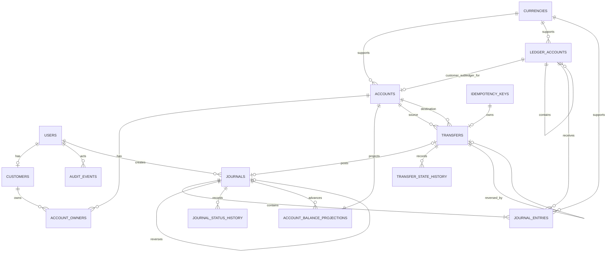

# BG Bank Database Schema Design

- **Status:** Proposed design for review; not implemented
- **Date:** 2026-11-05
- **Decision owner:** Project Owner
- **Scope:** Phase 2A design only

## 1. Purpose and boundaries

This document proposes the relational model for the first banking domains. It does not create tables, migrations, PostgreSQL functions, triggers, credentials, or live database changes.

The design follows the modular-monolith boundary:

- Identity owns authentication identities and lifecycle state; authentication flows are out of scope here.
- Customers owns customer profile information and its relationship to an identity.
- Accounts owns customer bank accounts, ownership and account lifecycle.
- Ledger owns the chart of accounts, journals, immutable entries and financial truth.
- Balances owns synchronous, rebuildable projections derived from posted ledger entries.
- Idempotency owns request deduplication and replayable outcomes.
- Audit owns append-only security and operational traceability.

Modules use public services and events. A module must not mutate another module's tables directly.

## 2. Proposed tables

### Identity and customer foundation

#### `users`

Authentication identity and lifecycle only. Passwords, OTPs, sessions and recovery secrets are intentionally not modeled in this phase; ADR-0005 defines the later session architecture.

| Column | Type | Nullability / notes |
|---|---|---|
| `id` | `uuid` | PK, generated by the application or database |
| `status` | `text` | NOT NULL; `pending`, `active`, `suspended`, `closed` |
| `created_at` | `timestamptz` | NOT NULL, UTC |
| `updated_at` | `timestamptz` | NOT NULL, UTC |
| `closed_at` | `timestamptz` | Nullable; set only when closed |

Constraints:

- `status` is a constrained value.
- `closed_at` is required when status is `closed` and absent otherwise, enforced by a check constraint or controlled lifecycle function.
- User rows are not physically deleted after they have audit or financial relationships.

#### `customers`

Customer-facing profile separated from authentication identity and ledger records.

| Column | Type | Nullability / notes |
|---|---|---|
| `id` | `uuid` | PK |
| `user_id` | `uuid` | NOT NULL FK to `users(id)`; UNIQUE for the initial one-customer-per-user model |
| `display_name` | `text` | NOT NULL; length checked |
| `country_code` | `char(2)` | NOT NULL; ISO-style code |
| `preferred_language` | `text` | NOT NULL; configured language code |
| `created_at` | `timestamptz` | NOT NULL |
| `updated_at` | `timestamptz` | NOT NULL |

PII should be minimized. Sensitive identity documents and authentication data belong in later bounded contexts, not in this table.

### Banking accounts

#### `currencies`

Reference data for supported currencies and their precision. Currency precision is data, not an assumption that every currency has two decimal places.

| Column | Type | Nullability / notes |
|---|---|---|
| `code` | `varchar(3)` | PK; uppercase ISO 4217-style code |
| `name` | `text` | NOT NULL |
| `minor_unit_exponent` | `smallint` | NOT NULL; non-negative, for example PKR=2, JPY=0, KWD=3 |
| `is_active` | `boolean` | NOT NULL; controls whether new financial activity may use it |
| `created_at` | `timestamptz` | NOT NULL |

Existing posted rows continue to reference a currency even if that currency is later deactivated. Deactivation prevents new accounts or postings; it does not rewrite history. Unsupported currency codes are rejected by foreign keys and controlled posting validation.

The table has a database check equivalent to `code = upper(code) AND code ~ '^[A-Z]{3}$'`. All currency-bearing columns use `varchar(3)` and reference `currencies(code)`. Support is explicit: a currency must exist in this table, and only `is_active = true` currencies may be selected for new accounts or postings through controlled functions. Future activation requires an authorized reference-data operation; deactivation does not invalidate historical rows.

#### `accounts`

A customer-visible bank account in one currency. A multi-currency customer therefore has multiple account rows or wallets, each with one explicit currency.

| Column | Type | Nullability / notes |
|---|---|---|
| `id` | `uuid` | PK |
| `account_number` | `text` | NOT NULL; UNIQUE, generated and non-sensitive display identifier |
| `account_type` | `text` | NOT NULL; initial values such as `current` or `savings` |
| `currency` | `varchar(3)` | NOT NULL; ISO 4217-style code |
| `status` | `text` | NOT NULL; `pending`, `active`, `frozen`, `dormant`, `closed` |
| `ledger_account_id` | `uuid` | NOT NULL part of composite FK `(ledger_account_id, currency) -> ledger_accounts(id, currency)`; one-to-one |
| `created_at` | `timestamptz` | NOT NULL |
| `updated_at` | `timestamptz` | NOT NULL |
| `closed_at` | `timestamptz` | Nullable |

Constraints:

- Ownership is authoritative through `account_owners`; `accounts` does not duplicate a customer owner column.
- `currency` must be supported by the configured currency table or seed set.
- `accounts.currency`, `ledger_accounts.currency`, and `journal_entries.currency` reference `currencies(code)`; inactive currencies cannot be selected for new records.
- The linked ledger account must be a customer deposit sub-ledger with the same currency; this cross-table kind/currency rule is enforced by controlled account-creation functions and posting validation, not by a simple foreign key alone.
- `ledger_account_id` is UNIQUE, so a customer sub-ledger belongs to at most one bank account.
- Add `UNIQUE (id, currency)` to support the composite account/currency foreign keys used by projections and transfers. The primary key remains `id`; the composite key exists for currency integrity.
- The foreign key cannot enforce `ledger_accounts.kind = 'customer_subledger'`; the controlled account-creation function and a database trigger/posting backstop must reject any other kind.
- `closed` is terminal and requires a zero ledger balance and no active holds in the later account-lifecycle implementation.
- Account identifiers are unique and are not used as database primary keys.
- Account creation is one controlled transaction: the account row, its customer-sub-ledger link, exactly one primary owner, and its initial zero-balance projection are created and validated together. An account cannot become `active` unless all four invariants pass and the linked currency relationships are valid.

#### `account_owners`

An explicit ownership join table leaves room for future joint accounts without changing `accounts`.

| Column | Type | Nullability / notes |
|---|---|---|
| `account_id` | `uuid` | PK part, FK to `accounts(id)` |
| `customer_id` | `uuid` | PK part, FK to `customers(id)` |
| `role` | `text` | NOT NULL; initially `primary` |
| `created_at` | `timestamptz` | NOT NULL |

Initial rule: exactly one `primary` owner is required for every active account. A partial unique index on `(account_id) WHERE role = 'primary'` prevents two primary owners, but cannot prove that one exists. Therefore account creation and ownership changes must use a controlled transaction/function that locks the account, validates the final owner set, and rejects an active account without exactly one primary owner. Joint ownership is deferred; the table is retained so a later approved phase can add additional non-primary owners without changing the account identity model.

### Ledger

#### `ledger_accounts`

The chart of accounts. It includes control accounts and customer sub-ledgers in the same ledger system.

| Column | Type | Nullability / notes |
|---|---|---|
| `id` | `uuid` | PK |
| `code` | `text` | NOT NULL, UNIQUE |
| `name` | `text` | NOT NULL |
| `account_type` | `text` | NOT NULL; `asset`, `liability`, `equity`, `income`, `expense` |
| `normal_side` | `text` | NOT NULL; `debit` or `credit` |
| `parent_id` | `uuid` | Nullable part of composite self-FK to `ledger_accounts(id, currency)` |
| `currency` | `varchar(3)` | NOT NULL; FK to `currencies(code)` |
| `kind` | `text` | NOT NULL; `control`, `customer_subledger`, `operational`, `clearing`, `suspense`, `income`, or `expense` |
| `status` | `text` | NOT NULL; `active` or `closed` |
| `created_at` | `timestamptz` | NOT NULL |

Constraints:

- A customer sub-ledger must have a parent Customer Deposits control account in the same currency.
- Add `UNIQUE (id, currency)` and enforce `(parent_id, currency) -> ledger_accounts(id, currency)` as a composite self-referencing foreign key. `parent_id IS NULL` is valid for top-level chart accounts; when it is non-null, the parent must exist in the same currency.
- `kind = 'customer_subledger'` is required for an account's linked ledger account.
- Customer Deposits control accounts are non-posting parent/reporting accounts. Their child customer sub-ledgers are the posting accounts. The parent kind, same-currency relationship, and non-posting behavior require a controlled function plus trigger; ordinary foreign keys cannot enforce `kind` or posting permissions.
- A ledger account cannot be its own parent.
- Circular hierarchies longer than one edge are also forbidden. Because a normal foreign key cannot prove acyclicity, ledger-account creation and parent changes must use a controlled function that locks the relevant hierarchy and walks ancestors before commit; a trigger is the database backstop. The function rejects any candidate whose parent chain reaches the candidate account.
- `normal_side` must agree with the account classification through seed validation.
- Financial rows are not soft-deleted.

#### `journals`

A journal is one business event and the unit that is posted atomically.

| Column | Type | Nullability / notes |
|---|---|---|
| `id` | `uuid` | PK |
| `journal_type` | `text` | NOT NULL; for example `internal_transfer`, `reversal`, `adjustment` |
| `status` | `text` | NOT NULL; `draft`, `posted`, `abandoned`, or `expired` |
| `business_reference` | `text` | NOT NULL; stable reference to the owning business operation |
| `reverses_journal_id` | `uuid` | Nullable self-FK; set on reversal journals |
| `posted_at` | `timestamptz` | Nullable until posted |
| `created_at` | `timestamptz` | NOT NULL |
| `created_by` | `uuid` | Nullable FK to `users(id)` for system-created records |

Constraints:

- A journal may be posted once only.
- A posted journal cannot return to draft or any terminal non-posted status.
- A reversal is a separate posted journal. It references exactly one original posted journal through `reverses_journal_id`, and a partial unique index permits at most one full reversal per original.
- A draft, abandoned, or expired journal has no `posted_at`; a posted journal has one.
- Drafts may transition only `draft -> posted`, `draft -> abandoned`, or `draft -> expired`. Abandonment is an explicit terminal status recorded in history; physical deletion is not used after a draft has an audit/history identity. Expiry is performed only by an authorized cleanup function after the configured pre-posting age. Posted journals and entries remain immutable.
- Every status change, including initial creation, is inserted into `journal_status_history` in the same transaction. The controlled functions reject a status change without its corresponding history row.

#### `journal_entries`

Immutable debit and credit lines belonging to a journal.

| Column | Type | Nullability / notes |
|---|---|---|
| `id` | `uuid` | PK |
| `journal_id` | `uuid` | NOT NULL FK to `journals(id)` |
| `ledger_account_id` | `uuid` | NOT NULL composite FK to `ledger_accounts(id, currency)` |
| `side` | `text` | NOT NULL; `debit` or `credit` |
| `amount_minor` | `bigint` | NOT NULL; strictly greater than zero |
| `currency` | `varchar(3)` | NOT NULL; must match the ledger account currency |
| `entry_position` | `integer` | NOT NULL; unique within a journal |
| `created_at` | `timestamptz` | NOT NULL |

There is no update or delete workflow for posted entries. Corrections create new reversal or adjustment journals.

Every entry currency references `currencies(code)`. The composite foreign key `(ledger_account_id, currency) -> ledger_accounts(id, currency)` enforces the currency match. The posting function and database backstop additionally reject non-posting control accounts and inactive currencies.

#### `journal_status_history`

Append-only record of journal lifecycle transitions. It prevents the design from referring to state history without defining it.

| Column | Type | Nullability / notes |
|---|---|---|
| `id` | `uuid` | PK |
| `journal_id` | `uuid` | NOT NULL FK to `journals(id)` |
| `from_status` | `text` | Nullable for initial creation |
| `to_status` | `text` | NOT NULL |
| `actor_type` | `text` | NOT NULL; `human`, `system`, or `ai` |
| `actor_user_id` | `uuid` | Nullable FK to `users(id)`; required only for human actors |
| `actor_reference` | `text` | Nullable stable service/job reference; required for `system`/`ai` |
| `reason` | `text` | NOT NULL |
| `request_id` | `text` | NOT NULL |
| `created_at` | `timestamptz` | NOT NULL |

Transitions are appended, not updated. Database checks require exactly one valid actor shape: `actor_type='human'` requires `actor_user_id IS NOT NULL` and `actor_reference IS NULL`; `actor_type='system'` requires `actor_user_id IS NULL` and a non-empty authorized service reference. `actor_type='ai'` is prohibited in this table. AI attribution is allowed in audit records only for analysis or recommendations and never for financial authorization or execution.

### Balance projections

#### `account_balance_projections`

Synchronous projections updated in the same transaction as journal posting. They are performance data, not the source of truth.

| Column | Type | Nullability / notes |
|---|---|---|
| `account_id` | `uuid` | PK part; composite FK to `accounts(id, currency)` |
| `currency` | `varchar(3)` | PK part; FK to `currencies(code)` |
| `ledger_balance_minor` | `bigint` | NOT NULL |
| `available_balance_minor` | `bigint` | NOT NULL |
| `last_posted_journal_id` | `uuid` | Nullable FK to `journals(id)` |
| `projection_version` | `bigint` | NOT NULL |
| `updated_at` | `timestamptz` | NOT NULL |

Balances are signed `BIGINT` minor-unit values using the ledger account's normal-side convention. For Phase 1, holds do not exist, so `available_balance_minor` equals `ledger_balance_minor`; the column is retained for the approved Phase 2 hold lifecycle. Computed-on-read balances are used for diagnostics and reconstruction, not as the primary Phase 1 runtime path. The posting function rejects a transfer that would make the source available balance negative.

The projection update locks the affected account rows in deterministic account-id order and occurs in the same database transaction as posting. Account creation must create the initial zero-balance projection in that same transaction; an active account cannot be committed without its projection. The composite account/currency relationship prevents a projection from being attached to another currency. `projection_version` records advancement but is not an account lock and cannot prevent overspending.

`projection_version` is incremented for every committed posting that changes the account projection. It is an optimistic consistency marker, not a replacement for row locking. `last_posted_journal_id` is a trace reference, not a complete cursor for every account: one journal can touch multiple accounts and journal IDs are not sufficient to prove that a projection has seen every relevant entry. Rebuild verification therefore compares the projection against all posted entries for the account and currency.

Missing projections are detected by an authorized reconciliation query comparing every active account with its required projection row. Repair is a controlled, audited operation: it locks the account, reconstructs the balance from posted entries, verifies the result, and creates or replaces the projection in a transaction. It is not an application self-healing path and is not implemented in Phase 1.

The existing `accounts.version` field is redundant with this projection-level version for Phase 1 and should be removed from the proposed schema. Account row locks still protect concurrent spending; `projection_version` records projection advancement.

### Idempotency and recovery

#### `transfers`

The business operation that owns an internal transfer. This is intentionally separate from its ledger journal.

| Column | Type | Nullability / notes |
|---|---|---|
| `id` | `uuid` | PK |
| `source_account_id` | `uuid` | NOT NULL FK to `accounts(id)` |
| `destination_account_id` | `uuid` | NOT NULL FK to `accounts(id)` |
| `amount_minor` | `bigint` | NOT NULL; greater than zero |
| `currency` | `varchar(3)` | NOT NULL; source and destination must match in Phase 1 |
| `state` | `text` | NOT NULL; `created`, `posted`, `completed`, or `rejected` |
| `journal_id` | `uuid` | Nullable until posted; FK to `journals(id)` |
| `reversal_of_transfer_id` | `uuid` | Nullable self-FK; at most one full reversal transfer per original, pending owner approval of the final transfer reversal policy |
| `idempotency_key_id` | `uuid` | NOT NULL, UNIQUE FK to `idempotency_keys(id)` |
| `created_at` | `timestamptz` | NOT NULL |
| `updated_at` | `timestamptz` | NOT NULL |

Constraints include `amount_minor > 0`, `source_account_id <> destination_account_id`, a currency FK, and composite foreign keys `(source_account_id, currency)` and `(destination_account_id, currency)` to `accounts(id, currency)`. `journal_id` is unique when present, so a transfer has at most one posting journal. A `created` or `rejected` transfer has `journal_id IS NULL`; `posted` and `completed` require a non-null journal. For an ordinary transfer (`reversal_of_transfer_id IS NULL`), that journal must have `journal_type='internal_transfer'` and a business reference identifying this transfer. For a reversal transfer, the journal must have `journal_type='reversal'`, `reverses_journal_id` pointing to the original transfer's journal, and a business reference identifying the reversal transfer. These conditional relationships require a controlled transfer/posting function or trigger in addition to ordinary checks and foreign keys. The approved ordinary path is `created -> posted -> completed`; `rejected` is terminal for a deterministic business failure. Application logic and a database transition function reject all other transitions.

The recommended deterministic-failure behavior is to create a `rejected` transfer and its initial/rejected state history in the same transaction as the terminal failed idempotency response. This records an auditable business outcome without posting a journal. Unexpected infrastructure or transaction failures roll back the entire transaction, including the transfer and idempotency row. This remains a proposed design choice, not implementation approval.

The recommended reversal policy is that the original transfer remains `completed`; a separate reversal transfer points to it through `reversal_of_transfer_id`, uses the same ordinary state flow, and owns a separate exact-opposite posted journal. Add a partial unique index `UNIQUE (reversal_of_transfer_id) WHERE reversal_of_transfer_id IS NOT NULL` to permit at most one full reversal transfer per original. A reversal must set `source_account_id` to the original destination, `destination_account_id` to the original source, and match the original amount and currency. It must reference a separate journal with `journal_type='reversal'`, `reverses_journal_id` pointing to the original journal, and a business reference identifying the reversal transfer. The original journal's business reference identifies the original transfer. These cross-row checks require the controlled reversal function and database backstop. This preserves immutable history. Whether this relationship and status treatment are the final product policy remains an owner decision; a `reversed` state is not included in the Phase 1 state check until approved.

#### `transfer_state_history`

Append-only transition history for the `transfers` state machine.

| Column | Type | Nullability / notes |
|---|---|---|
| `id` | `uuid` | PK |
| `transfer_id` | `uuid` | NOT NULL FK to `transfers(id)` |
| `from_state` | `text` | Nullable for initial creation |
| `to_state` | `text` | NOT NULL |
| `actor_user_id` | `uuid` | Nullable FK to `users(id)` for system actions |
| `actor_type` | `text` | NOT NULL; `human`, `system`, or `ai` |
| `actor_reference` | `text` | Nullable stable service/job reference; required for `system`/`ai` |
| `reason` | `text` | NOT NULL |
| `request_id` | `text` | NOT NULL |
| `created_at` | `timestamptz` | NOT NULL |

Illegal transitions are rejected by the approved application state machine and persisted transition records; the exact transition table is part of the transfer implementation phase. Database checks require exactly one valid actor shape: `actor_type='human'` requires `actor_user_id IS NOT NULL` and `actor_reference IS NULL`; `actor_type='system'` requires `actor_user_id IS NULL` and a non-empty authorized service reference. `actor_type='ai'` is prohibited in this table. AI may be recorded in audit metadata for analysis or recommendations, but cannot initiate or execute transfer transitions, journal transitions, posting, or financial mutations.

#### `outbox_events`

Transactional events emitted after financial state changes. The outbox is included because the approved architecture requires the event row to commit with the business transaction.

| Column | Type | Nullability / notes |
|---|---|---|
| `id` | `uuid` | PK; stable event identifier |
| `event_type` | `text` | NOT NULL |
| `aggregate_type` | `text` | NOT NULL |
| `aggregate_id` | `uuid` | NOT NULL |
| `payload` | `jsonb` | NOT NULL; no secrets |
| `state` | `text` | NOT NULL; `pending`, `processing`, `published`, `dead_letter` |
| `attempt_count` | `integer` | NOT NULL DEFAULT 0 |
| `next_attempt_at` | `timestamptz` | NOT NULL |
| `claimed_at` | `timestamptz` | Nullable lease timestamp |
| `lease_expires_at` | `timestamptz` | Nullable; required while `processing` |
| `worker_id` | `text` | Nullable worker identity |
| `claim_token` | `uuid` | Nullable claim token; prevents a stale worker from completing another worker's lease |
| `published_at` | `timestamptz` | Nullable |
| `last_error_code` | `text` | Nullable; safe operational code only |
| `created_at` | `timestamptz` | NOT NULL |

Workers claim events with `FOR UPDATE SKIP LOCKED`, setting `claimed_at`, `lease_expires_at`, a non-empty `worker_id`, and a fresh `claim_token` on every initial claim or reclaim while changing state to `processing`. A processing row requires all four lease fields plus `lease_expires_at > claimed_at`. Pending, published, and dead-letter rows require all lease fields to be null; `published` additionally requires non-null `published_at`, while pending, processing, and dead-letter require `published_at IS NULL`. A worker failure leaves an expired lease; another worker may reclaim it atomically after checking `lease_expires_at`. `attempt_count >= 0` is enforced, and every worker update must match the event ID, `state='processing'`, and current claim token. A stale worker's update affects zero rows after reclamation and cannot modify the new claim. Exhausted retries move to `dead_letter` with a safe error code. Delivery is at-least-once, never exactly-once; consumers deduplicate by event ID. Dead-letter replay is authorized and creates a new claim, not a duplicate financial operation.

#### `idempotency_keys`

Stores one durable outcome per scoped financial request, following ADR-0004.

| Column | Type | Nullability / notes |
|---|---|---|
| `id` | `uuid` | PK |
| `scope` | `text` | NOT NULL; includes authenticated principal and operation |
| `key` | `text` | NOT NULL; client-supplied, length checked |
| `request_hash` | `char(64)` | NOT NULL; SHA-256 of canonical validated input |
| `state` | `text` | NOT NULL; `processing`, `completed`, or terminal deterministic `failed` |
| `response_status` | `smallint` | Nullable while `processing`; required in a terminal state |
| `response_body` | `jsonb` | Nullable while `processing`; required in a terminal state, bounded and free of secrets |
| `resource_type` | `text` | Nullable |
| `resource_id` | `uuid` | Nullable |
| `created_at` | `timestamptz` | NOT NULL |
| `expires_at` | `timestamptz` | NOT NULL |
| `completed_at` | `timestamptz` | Nullable; set when a terminal response is stored |
| `failure_code` | `text` | Nullable safe business failure code |

Unique constraint:

```text
UNIQUE (scope, key)
```

The idempotency row, transfer, journal, entries, state history, audit event, outbox event and final response are committed in one transaction. `processing` is an in-transaction working state in synchronous Phase 1; it cannot independently commit because a committed processing row could strand a request without a financial outcome. The final response is written before the transaction commits. A lost HTTP response is recovered by replaying the stored response. A rollback removes the processing row and all financial records, so retrying the same key is safe.

Concurrent requests with the same `(scope, key)` are serialized by the unique constraint and transaction conflict. The winner completes the financial transaction; the loser waits for the outcome, then reads and replays the committed result. The same key with a different canonical request hash returns `409 Conflict` and never executes. Deterministic business failures commit a terminal `failed` response atomically; unexpected validation, database, timeout, or infrastructure failures roll back and leave no replayable outcome.

The synchronous Phase 1 transaction uses PostgreSQL `READ COMMITTED` plus row locks and the unique `(scope, key)` constraint. A unique-conflict loser must roll back its failed insert attempt, start a fresh read transaction, and read only the winner's committed row before replaying it. Serialization failures or deadlocks are safe to retry only at the whole-request transaction boundary, using the same idempotency key and canonical hash; no partial financial step is retried independently. The processing row still cannot commit separately from the financial outcome.

An expired key is not immediately reusable. Cleanup must retain a tombstone or otherwise preserve a reuse barrier for the approved replay-risk period; otherwise an old client retry could execute again under the same key. The retention period and cleanup authorization remain open decisions. Cleanup must not remove a key while its financial outcome can still be retried safely.

Outbox delivery is at-least-once. Workers claim rows with a lease, retry transient failures with bounded exponential backoff and jitter, and move exhausted events to `dead_letter` with a safe error code. Consumers deduplicate by `event_id`. Dead-letter replay is an authorized operation and remains idempotent; raw provider responses, credentials and sensitive error details are not stored in the outbox.

### Audit foundation

#### `audit_events`

Append-only traceability for sensitive security and operational actions.

| Column | Type | Nullability / notes |
|---|---|---|
| `id` | `uuid` | PK |
| `actor_type` | `text` | NOT NULL; `human`, `system`, or `ai` |
| `actor_user_id` | `uuid` | Nullable FK to `users(id)`; required for `human` |
| `actor_reference` | `text` | Nullable stable service/job reference; required for `system` or `ai` |
| `action` | `text` | NOT NULL |
| `target_type` | `text` | NOT NULL |
| `target_id` | `uuid` | Nullable when a target is not addressable by UUID |
| `request_id` | `text` | NOT NULL |
| `metadata` | `jsonb` | NOT NULL DEFAULT `{}`; minimized, no secrets |
| `created_at` | `timestamptz` | NOT NULL |

Database checks require exactly one actor shape: `human` requires `actor_user_id IS NOT NULL` and `actor_reference IS NULL`; `system` or `ai` require `actor_user_id IS NULL` and `actor_reference IS NOT NULL`. `ai` is an attribution value only: it cannot authorize or execute financial state mutations, call posting functions, or receive a financial state-transition role. Audit rows are append-only through database permissions and an append-only trigger; only an authorized retention/redaction process may remove or redact data, and it must preserve the event identity and investigation value. Retention duration and the exact redaction policy remain open decisions. Do not store passwords, tokens, OTPs, full payment-card data, connection strings, or unnecessary PII.

## 3. Chart-of-accounts seed design

The exact codes remain an open implementation decision, but the initial seed should include separate currency-specific accounts:

| Account family | Classification | Purpose |
|---|---|---|
| Customer Deposits — `<currency>` | Liability/control | Total customer deposit liability for one currency |
| Customer Deposit Sub-ledger — `<customer>/<currency>` | Liability/sub-ledger | Detail account under the matching deposit control account |
| Simulated Cash/Clearing — `<currency>` | Asset/clearing | Simulated settlement position |
| Suspense — `<currency>` | Asset or liability per policy | Temporary named location for unexplained outcomes |
| Fee Income — `<currency>` | Income | Explicit fees earned by the bank simulation |
| FX Clearing — `<currency>` | Asset or liability/clearing | Intermediate FX settlement position |
| FX Gain/Loss — `<currency>` | Income/expense | Explicit rate, spread, or rounding differences |

The seed must document the normal side, parent relationship, currency, and why each account exists. It must not invent a single base-currency shortcut for multi-currency accounting.

## 4. Relationships and cardinality

- One `user` has zero or one initial `customer` profile; a customer references exactly one user in the initial model.
- One customer owns one or more accounts through `account_owners`; `account_owners` is the sole authoritative ownership model.
- Every active account has exactly one primary owner. Joint ownership is deferred from the initial implementation.
- One account has exactly one customer deposit sub-ledger account.
- One customer sub-ledger belongs to at most one bank account.
- One ledger account may have zero or one parent control account.
- One journal has two or more journal entries before posting.
- One journal entry belongs to exactly one journal and one ledger account.
- One account has one balance projection per currency; the account currency and projection currency must match.
- One transfer has one source and one destination account, and its currency must match both accounts.
- One transfer has at most one posting journal; a reversal transfer has its own journal and points to the original transfer.
- One idempotency key produces one stored outcome.
- One audit event may reference one actor and one target, but system actions may have no actor user.
- One account and its linked ledger account reference the same currency.

## 5. Integrity constraints and indexes

The posting invariants are explicit:

- A posted journal has at least two entries.
- Debit totals equal credit totals independently for each currency.
- Every entry has a positive `BIGINT` minor-unit amount.
- Every entry currency matches its ledger account currency and references `currencies`.
- Every account currency matches its linked customer-sub-ledger currency through a composite foreign key.
- Every projection currency matches its account currency through a composite foreign key.
- Transfer amount is positive, source and destination differ, and transfer currency matches both accounts.
- A journal can be posted only once; duplicate posting is rejected.
- A full reversal is a new posted journal with exact opposite entries and cannot be repeated.
- Posted journals and entries cannot be updated or deleted.
- The runtime application role cannot bypass the controlled posting functions.
- A posted journal's status history is inserted in the same transaction as the status change; a journal cannot become posted without its history row.
- Exactly one primary owner for an active account is checked at the end of the controlled ownership transaction; the partial unique index prevents duplicates but cannot prove existence by itself.

Customer Deposits control accounts are reporting/control parents, not additional customer money. A customer's sub-ledger entry is the detail; the control account's balance is reconciled to the sum of its child sub-ledgers. The same economic amount must not be posted once to a customer sub-ledger and again as an independent customer-deposit balance, which would double-count the liability.

## 5a. Proposed ER diagram



`LEDGER_ACCOUNTS ||--o| ACCOUNTS` deliberately shows that only customer-sub-ledger ledger accounts can be linked to a bank account; many operational, control, clearing, suspense, income and expense ledger accounts have no bank-account row. The requirement that every active bank account has exactly one such link is enforced by the account composite foreign key and controlled account-creation function. `OUTBOX_EVENTS` is intentionally not connected in the diagram: its `(aggregate_type, aggregate_id)` pair is a generic polymorphic reference and therefore is not a normal foreign key to transfers or any single domain table.

The `TRANSFERS o|--o| JOURNALS` relationship represents nullable `transfers.journal_id`: a transfer may have zero or one journal, and a journal may belong to zero or one transfer. The unique nullable `journal_id` constraint enforces the maximum-one-transfer-per-journal rule. Controlled functions enforce the conditional journal type and business-reference rules; the ER diagram does not encode those checks.

The diagram intentionally omits authentication-session, hold, KYC, beneficiary and payment-rail tables because those are separate implementation phases or explicitly out of scope for this design.

Required constraints include:

- UUID primary keys.
- Foreign keys for every ownership, account, journal, entry, projection, actor, and reversal relationship.
- Positive `amount_minor` and `amount_minor` within PostgreSQL `bigint` bounds.
- Explicit three-letter currency values.
- `side IN ('debit', 'credit')`.
- `status` checks for each lifecycle.
- Same currency between an account and its ledger sub-account.
- Unique account number and ledger code.
- Unique `(scope, key)` idempotency key.
- Unique entry position per journal.
- At most one full reversal per original journal.
- No posted journal mutation or deletion.

Composite-key completeness: `accounts(id, currency)`, `ledger_accounts(id, currency)`, and the corresponding unique constraints are required before declaring these references: `(ledger_account_id, currency) -> ledger_accounts(id, currency)` for accounts and entries; `(parent_id, currency) -> ledger_accounts(id, currency)` for ledger hierarchy; `(account_id, currency) -> accounts(id, currency)` for projections; and `(source_account_id, currency)` / `(destination_account_id, currency) -> accounts(id, currency)` for transfers. Each participating column is explicitly present in the child table. The `currencies(code)` foreign key remains separate and rejects unsupported currency codes; active/inactive selection requires a controlled function because a normal FK does not inspect the referenced row's status.

Recommended indexes:

- `customers(user_id)` unique.
- `account_owners(customer_id)` for customer account lookup.
- `account_owners(customer_id, account_id)` for customer account lookup, with account status filtered after the join.
- `accounts(account_number)` unique.
- `ledger_accounts(code)` unique.
- `journals(business_reference, journal_type)` for traceability.
- `journal_entries(ledger_account_id, created_at DESC)` for account history.
- `journal_entries(journal_id, entry_position)` unique and ordered retrieval.
- `journals(reverses_journal_id) WHERE reverses_journal_id IS NOT NULL` unique for full reversal enforcement.
- `idempotency_keys(scope, key)` unique.
- `idempotency_keys(expires_at)` for retention cleanup.
- `audit_events(target_type, target_id, created_at DESC)` for investigation.

Financial queries must be designed before adding indexes. Avoid speculative indexes on every column.

## 6. Ledger posting and reversal model

The application must use controlled PostgreSQL functions described by ADR-0006:

1. Create a draft journal through a controlled function; only the posting service role may create or abandon drafts.
2. Add draft entries through the controlled entry function. Draft entries are not balances and cannot be posted directly by the runtime role.
3. Call `post_journal()` inside the application transaction.
4. Validate at least two entries and independent debit-credit equality per currency.
5. Validate account/currency relationships, supported active currency, positive amounts, posting-account kind, the no-cross-currency rule, and the transfer/journal type and business-reference relationship when a transfer owns the journal.
6. Mark the journal posted once.
7. Update the synchronous balance projection in the same transaction, after locking affected accounts in deterministic order.
8. Write the journal status history, audit event and outbox event in the same transaction. The initial draft history and the final posted history are both committed atomically with their corresponding journal state.

A full reversal creates a separate new journal with `status='posted'` and `reverses_journal_id` pointing to the original posted journal. The original journal remains `posted` and immutable; it is never changed to `reversed` and its entries are never edited or deleted. The original's reversal relationship is represented by the new journal.

The controlled reversal function must:

1. Lock the original journal and its entries.
2. Verify the original is posted and has no existing full reversal.
3. Read every original entry and construct the opposite side with the same account, currency and positive amount.
4. Verify the candidate reversal has the same number of entries and equal total per currency.
5. Create and post the new journal atomically.
6. Update affected balance projections and write state history, audit and outbox records.

The new journal's entries must be an exact multiset inverse of the original entries: each original debit becomes a reversal credit and each original credit becomes a reversal debit, with identical ledger account, currency, amount and entry count. A unique partial index or controlled function prevents a second full reversal. Partial reversals remain deferred.

## 7. Transaction boundaries and concurrency

An ordinary Phase 1 same-currency internal transfer must commit these records atomically:

```text
idempotency key
transfer record (future Phase 1 implementation)
journal and journal entries
balance projection
state history
audit event
outbox event
final idempotency response
```

The transaction must:

1. Claim the scoped idempotency key.
2. Lock source and destination account rows in deterministic UUID order.
3. Verify account status and available funds.
4. Post one balanced journal.
5. Update the projection synchronously.
6. Persist the outcome and commit.

No network provider call occurs while financial account locks are held. Concurrent requests for the same idempotency key are resolved by the unique constraint; concurrent spending is serialized by deterministic account locking.

## 8. Data lifecycle and deletion restrictions

- Financial journals, journal entries, reversals, projections' audit references, idempotency outcomes and audit events are not hard-deleted through application workflows.
- Posted financial rows are append-only.
- User/customer PII deletion must be a later retention and privacy decision that preserves financial traceability.
- Expired idempotency records may be removed only after the approved retention policy and replay-risk analysis are defined.
- Draft journals may be abandoned or expired only through a controlled lifecycle rule; they must never be mistaken for posted financial history.
- Audit metadata must be minimized and retained according to a later policy.

## 9. Security considerations

- The runtime application role must not own ledger tables or receive unrestricted UPDATE/DELETE privileges.
- Privileged posting functions must use a fixed safe `search_path` and restricted `EXECUTE` grants.
- Database roles and grants belong in reviewed migrations, not ad-hoc setup.
- Row-level authorization remains an application/service concern for customer resources.
- Database errors must be mapped to safe API errors; connection strings and SQL details never appear in responses or logs.
- AI tools may read only fixed, permission-checked projections and records. AI cannot call posting functions or mutate financial tables.
- Audit metadata must not contain credentials, tokens, OTPs, or unnecessary sensitive data.

## 10. Migration strategy

### Ordering

The initial migration sequence should be:

1. Enable required PostgreSQL extensions only if explicitly approved.
2. Create `currencies` and seed supported currency metadata.
3. Create shared enum/check conventions.
4. Create `users` and `customers`.
5. Create `ledger_accounts` and seed the currency-specific chart of accounts.
6. Create `accounts` and `account_owners`, with the controlled primary-owner invariant.
7. Create `journals`, `journal_entries` and `journal_status_history`.
8. Create `idempotency_keys`.
9. Create `transfers` and `transfer_state_history` when the transfer implementation is approved.
10. Create balance projections.
11. Create `audit_events`.
12. Create `outbox_events`.
13. Create posting/reversal functions, deferred validation triggers, append-only triggers, roles and grants.

This order follows foreign-key dependencies. Exact account seed codes and role names remain unresolved.

### Safe constraint introduction

- Create tables and non-destructive checks before enabling application writes.
- Add foreign keys in dependency order.
- For future large datasets, consider `NOT VALID` followed by validation, but the clean initial database should validate immediately.
- Add deferred journal validation before any posting endpoint exists.
- Test append-only triggers and grants with a restricted runtime role.

### Functions and triggers

PostgreSQL functions, deferred constraint triggers, append-only triggers, roles and grants must be version-controlled in Drizzle SQL migrations. Ordinary Drizzle declarations can describe columns and relationships, but they are not sufficient for all ledger enforcement behavior.

### Testing migrations

Each migration should be tested against:

- A clean PostgreSQL 16 database.
- A database upgraded through all prior migrations.
- A restricted runtime role.
- Invalid unbalanced journals.
- Cross-currency imbalance.
- Direct posted-entry UPDATE/DELETE attempts.
- Duplicate posting and duplicate reversal.
- Projection rebuild and mismatch detection.

### Rollback limitations

Financial migrations should prefer forward-compatible fixes. Dropping or rewriting posted financial structures is not a normal rollback. A failed migration may be rolled back before financial data exists; after data exists, use a corrective migration and preserve history.

### Clean local initialization

A clean local database should be created with the approved isolated PostgreSQL 16 settings, then initialized only through reviewed migrations and seed scripts. No ad-hoc SQL or manual ledger rows should be used. This phase does not create the container or execute migrations.

## 11. Drizzle compatibility

The current backend uses `drizzle-orm` with the Node PostgreSQL driver and Drizzle Kit configured for PostgreSQL. The proposed schema maps naturally to Drizzle table declarations for ordinary tables, UUIDs, text/check constraints, timestamps, JSONB and indexes.

These features should be expressed in SQL migrations or carefully reviewed Drizzle custom SQL:

- Deferred constraint triggers for final journal balancing.
- `post_journal()` and draft-entry functions.
- Append-only triggers for posted journals and entries.
- Database roles, ownership and `GRANT`/`REVOKE` statements.
- Function security settings and fixed `search_path`.
- Any deferrable foreign keys or advanced partial indexes not fully represented by the chosen Drizzle version.

No dependency beyond the already selected Drizzle ORM, Drizzle Kit, PostgreSQL driver and existing NestJS foundation is required for this design.

## 12. Review against approved decisions

- **ADR-0002:** Uses one ledger and customer sub-ledgers under currency-specific Customer Deposits control accounts.
- **ADR-0003:** Uses `BIGINT` minor units and explicit currencies; the ADR remains Proposed.
- **ADR-0004:** Stores canonical request hashes and final responses atomically with financial records.
- **ADR-0005:** Does not implement authentication; it preserves separation between user identity and customer data and leaves sessions to the approved session architecture.
- **ADR-0006:** Uses controlled posting functions, restricted roles, deferred validation, append-only records and independent per-currency balancing.
- **Project source of truth:** Keeps Phase 1 immediate same-currency atomic transfers and treats holds and pending/external flows as future Phase 2 behavior.

No accepted decision is changed by this proposal. Acceptance of an ADR does not mean that this schema, its migrations or its enforcement code has been implemented or verified.

## 13. Open questions requiring approval

The following are the remaining project-owner decisions:

1. Exact chart-of-accounts codes and whether control accounts are seeded per currency at initialization.
2. Exact PostgreSQL role names, ownership model, and local developer access boundaries.
3. Final reversal-transfer product policy, including whether the original transfer remains `completed` and how the reversal is exposed.
4. Idempotency retention duration and cleanup authorization.
5. Exact audit metadata retention and PII redaction policy.
6. Whether a separate system-actor identity table is needed later.

The following are already-defined mechanisms, not open architectural decisions: composite currency keys, actor-shape checks, controlled account activation, draft terminal statuses, transfer/journal conditional validation, rejected-transfer atomic persistence, outbox claim-token leases, projection initialization and authorized repair, and the use of `varchar(3)` uppercase currency codes. Their exact SQL/function signatures and implementation details remain part of the later implementation review, but they must follow this proposed design rather than be reconsidered as new product decisions.

## 14. Explicit non-goals

This design does not implement:

- Authentication or sessions
- Accounts APIs
- Transfers, deposits or withdrawals
- Ledger posting code
- Holds or pending payment flows
- KYC/AML or risk rules
- External providers
- Database tables or migrations
- Live database changes
